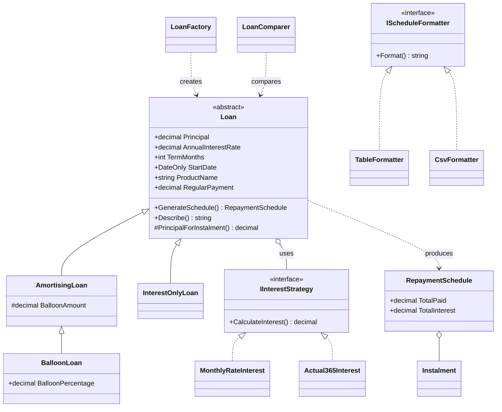

# Loan Repayment Engine


A C# (.NET 8) library that models different kinds of loans and produces their repayment schedules. It was built to show object-oriented design on a problem with real business rules: the same loan can be repaid in several ways, and each way costs a different amount.

Three loan types are included, and they can be compared side by side:

| Loan type | How it is repaid |
|---|---|
| Amortising | Equal monthly instalments until the debt is cleared |
| Interest-only | Interest each month, then the whole principal with the final instalment |
| Balloon | Smaller monthly instalments, then a lump sum (a percentage of the principal) at the end |

## Where the OOP concepts appear

| Concept | Where to look | What it shows |
|---|---|---|
| Abstraction | `Loans/Loan.cs` | An abstract base class defines what every loan can do. Calling code works with `Loan` and never needs to know the concrete type. |
| Inheritance | `AmortisingLoan`, `InterestOnlyLoan`, `BalloonLoan` | `BalloonLoan` extends `AmortisingLoan` and overrides one property, so it reuses every other line. |
| Polymorphism | `Comparison/LoanComparer.cs` | One method takes a mixed list of loans and calls the same methods on each, with no type checks. |
| Encapsulation | `Loan` constructor, `RepaymentSchedule` | State is validated once, then exposed read-only. The schedule copies its list and cannot be changed afterwards. |
| Template Method | `Loan.GenerateSchedule()` | The base class owns the repayment loop. Subclasses only supply the parts that differ. |
| Strategy | `Interest/` | Interest calculation is an interface (`IInterestStrategy`) with two implementations, and a loan is given one rather than hard-coding it. |
| Factory | `Loans/LoanFactory.cs` | One place decides which class to build. |
| Interfaces and dependency injection | `IInterestStrategy`, `IScheduleFormatter` | New interest rules or output formats are added as new classes, with no changes to existing code. |
| Custom exceptions | `InvalidLoanException` | Business-rule failures are reported with clear messages. |

## Class diagram



## Quick start

Requires the [.NET 8 SDK](https://dotnet.microsoft.com/download/dotnet/8.0).

```
git clone https://github.com/KabeloCode-Byte/loan-repayment-engine.git
cd loan-repayment-engine
dotnet run --project src/LoanEngine.Console -- 500000 11.5 60
```

The three arguments are the principal in rand, the annual interest rate in percent, and the term in months. All are optional (defaults: 500000, 11.5, 60). Add `--csv schedule.csv` to save the schedule so it opens in Excel or Power BI.

### Example output

Due dates start one month after the day you run it.

```
Loan options compared (cheapest first)
====================================================================================================
Amortising loan: R500,000.00 at 11.5% over 60 months (monthly rate)
    first payment R10,996.30   total interest R159,778.34   total paid R659,778.34
Balloon loan: R500,000.00 at 11.5% over 60 months (monthly rate), balloon 30% (R150,000.00)
    first payment R9,134.91   total interest R198,094.79   total paid R698,094.79
Interest-only loan: R500,000.00 at 11.5% over 60 months (monthly rate)
    first payment R4,791.67   total interest R287,500.20   total paid R787,500.20
```

The comparison makes the trade-off visible: the balloon and interest-only loans have lower monthly payments, but they cost about R38,000 and R128,000 more in interest over the same five years.

### Using the library

```csharp
var request = new LoanRequest(750_000m, 0.115m, 60, new DateOnly(2026, 1, 15))
{
    BalloonPercentage = 0.30m,
    InterestStrategy = new Actual365Interest(),
};

Loan loan = LoanFactory.Create(LoanType.Balloon, request);
RepaymentSchedule schedule = loan.GenerateSchedule();

Console.WriteLine(loan.Describe());
Console.WriteLine($"Total interest: {schedule.TotalInterest:N2}");
Console.WriteLine(new CsvFormatter().Format(loan, schedule));
```

## Tests

```
dotnet test
```

38 xUnit test cases cover the loan calculations, validation, the factory, the comparer and the output formats. The expected figures were worked out separately from the C# code, so the tests check the code against a second calculation, not against itself. For example, R100,000 at 12% over 12 months is the well-known R8,884.88 a month.

One test runs the same checks on every combination of loan type and interest strategy: each schedule must have the right number of instalments, each payment must equal interest plus principal, the balance must fall correctly, due dates must increase, and the final balance must be exactly zero.

## Design decisions

- **`decimal`, never `double`.** Money must not pick up binary rounding errors. Interest is rounded to the cent (half away from zero) at each instalment.
- **The last instalment clears the balance.** Rounding every month leaves a few cents of difference, so the final payment absorbs it. This is how lenders handle it, and it guarantees the balance ends at exactly zero.
- **Due dates count from the start date.** Adding months one by one would drift (31 Jan, 28 Feb, 28 Mar). Counting from the start date gives 31 Jan, 28 Feb, 31 Mar.
- **Rates are fractions.** `0.115` means 11.5%. The console app converts from percent for you.
- **Inputs are validated in the constructor.** An invalid `Loan` object can never exist, so the rest of the code does not need to re-check.

## Limitations

This is a learning and portfolio project, not a lending system. It does not model fees, insurance, variable rates, early settlement, payment holidays or the legal rules that apply to real credit agreements (in South Africa, the National Credit Act). Do not use it to make financial decisions. It is not connected to any employer or institution.

## Ideas for extension

- A seasonal loan whose repayments fall in harvest months, as a new `Loan` subclass
- Early settlement and extra payments
- A variable-rate strategy where the rate changes on set dates
- A small web API on top of the library (ASP.NET Core)
- JSON output as another `IScheduleFormatter`

## Author

Kabelo Mokgobu, [GitHub](https://github.com/KabeloCode-Byte)
